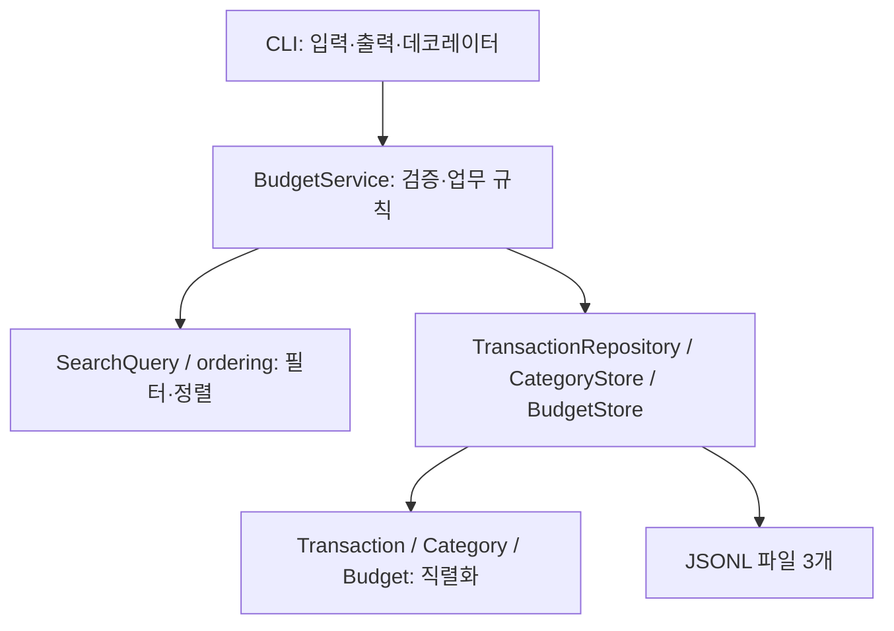

# budget_app — 콘솔 가계부

표준 라이브러리만으로 만든 파일 기반 콘솔 가계부입니다.
수입/지출 내역의 추가·조회·검색·수정·삭제, 월별 요약, 예산 경고, 카테고리 관리,
CSV 가져오기/내보내기를 지원합니다.

- **제너레이터 스트리밍**: 저장 파일을 한 번에 로드하지 않고 한 줄씩 처리
- **데코레이터**: 예외 처리 / 실행 로그 / 실행 시간 측정을 공통 분리
- **타입 힌트**: 함수·데이터 구조의 계약을 명시
- **모듈화**: 모델 / 저장소 / 서비스 / CLI 계층 분리
- **원자적 저장**: update/delete 시 임시 파일 작성 후 `os.replace` 로 교체

## 요구 환경

- Python 3.10 이상 (외부 패키지 불필요, 표준 라이브러리만 사용)

VS Code에서는 이 프로젝트 폴더를 열고 터미널에서 실행하세요. 아래 예시의 `python`이 없거나 다른 버전을 가리키면 `python3`로 바꾸어 실행합니다. `python3 --version`으로 버전을 확인할 수 있으며, 별도의 `pip install`은 필요하지 않습니다.

## 실행 방법

프로젝트 루트(이 README가 있는 폴더)에서 모듈로 실행합니다.

```bash
python -m budget_app <command> [options]
```

모든 명령은 `--help` 로 사용법을 볼 수 있습니다.

```bash
python -m budget_app --help
python -m budget_app add --help
python -m budget_app summary --help
```

- 공통 옵션: `--data-dir <폴더>` (저장 위치 변경), `--verbose` (실행 로그/시간 출력)
- 공통 옵션은 명령 앞이나 뒤, 하위 명령 앞이나 뒤에 사용할 수 있습니다. 같은 옵션을 여러 번 지정하면 마지막 값이 적용됩니다.
- 정상 종료 코드는 `0`, 오류 종료 코드는 `0`이 아닌 값입니다.
- 오류는 스택트레이스 대신 `[오류] 원인` + `[힌트] 해결 방법` 형태로 출력됩니다.

## 저장 파일 위치 / 형식

- 기본 저장 폴더: `./data` (`--data-dir` 로 변경 가능, 없으면 자동 생성)
- 형식: **JSONL** (한 줄에 JSON 객체 1개), UTF-8
- 파일은 3개로 분리:

| 파일 | 내용 | 레코드 예시 |
| --- | --- | --- |
| `transactions.jsonl` | 거래 내역 | `{"id": "TX-000001", "type": "expense", "date": "2024-01-15", "amount": 15000, "category": "food", "memo": "점심", "tags": ["meal"]}` |
| `categories.jsonl` | 카테고리 | `{"name": "food"}` |
| `budgets.jsonl` | 월 예산 | `{"month": "2024-01", "amount": 500000}` |

- 실행 시 카테고리 파일이 없거나 비어 있으면 기본 카테고리(`food, transport, rent, salary, etc`)가 자동 생성됩니다. 등록된 카테고리가 있으면 그대로 유지합니다.
- 별도의 메타 파일이나 스키마 버전 필드는 없습니다. 현재 스키마는 아래 모델과 `to_dict`/`from_dict`가 정의합니다. `memo`, `tags`가 없는 기존 거래는 각각 빈 문자열과 빈 목록으로 읽습니다.
- 향후 호환되지 않는 형식 변경에는 버전 메타데이터와 별도의 마이그레이션이 필요합니다. 현재는 자동 마이그레이션을 수행하지 않습니다. 변환은 원본을 보존한 상태에서 임시 파일 작성 → 전체 검증 → 교체하는 방식으로 설계해야 합니다.

### JSONL과 CSV 비교 / 선택 근거

| 관점 | JSONL | CSV |
| --- | --- | --- |
| 가독성·크기 | 각 레코드에 필드명이 있어 한 줄만 봐도 의미를 알 수 있지만, 키 반복으로 파일이 커짐 | 표로 읽기 좋고 같은 데이터는 대체로 작지만, 컬럼 의미는 헤더와 연결해서 읽어야 함 |
| 타입·구조 | 금액은 숫자, 태그는 문자열 배열로 그대로 표현 | 읽은 필드는 문자열이므로 금액 변환, 태그 구분자 등 별도 규칙이 필요 |
| 스트리밍 | 한 물리적 줄이 한 객체이며 메모 줄바꿈은 이스케이프됨. 줄 단위로 파싱 가능 | `csv.reader`로 스트리밍 가능. 따옴표 안의 줄바꿈 때문에 단순한 줄 분리는 불가능 |
| 추가·수정 | 한 객체를 끝에 추가 가능. 수정/삭제는 파일 재작성 | 한 레코드를 끝에 추가 가능. 수정/삭제는 파일 재작성 |
| 오류·무결성 | 줄마다 독립 파싱하고 오류 줄 번호를 특정하기 쉬움. 잘못된 JSON은 저장소 오류로 처리 | 헤더·필수 컬럼·인코딩·따옴표 구조 검사 필요. 닫히지 않은 따옴표는 뒤의 레코드 파싱에도 영향 |
| 필드 확장 | 새 키와 기본값으로 호환 가능한 확장 가능 | 헤더/컬럼 규칙을 함께 변경해야 함 |
| 외부 도구 | 텍스트 편집기에서 확인하기 좋음 | 스프레드시트와 다른 가계부의 교환 형식으로 편리 |

내부 저장에는 **JSONL**을 선택했습니다. 거래의 `tags: list[str]`와 여러 줄 메모를 표현하기 쉽고, 거래·카테고리·예산 저장소가 같은 줄 단위 읽기/쓰기 함수를 공유할 수 있기 때문입니다. CSV는 사용자가 다른 도구와 데이터를 주고받는 경계에서 사용합니다.

어느 형식도 그 자체로 원자적 저장이나 업무 규칙 검증을 보장하지 않습니다. 입력 검증, 임시 파일, `flush`/`fsync`, `os.replace` 및 추가 실패 시 길이 복구가 데이터 보호를 담당합니다.

## 데이터 모델

- `Transaction`: `id`, `type`(income/expense), `date`(YYYY-MM-DD), `amount`(양수 정수), `category`, `memo`(선택), `tags`(선택)
- `Category`: `name`
- `Budget`: `month`(YYYY-MM), `amount`(양수 정수)

## 주요 명령 예시

### add — 거래 추가 (대화형)

```bash
$ python -m budget_app add
거래를 추가합니다. (취소: Ctrl+C)
날짜(YYYY-MM-DD): 2024-01-15
타입(income/expense): expense
카테고리: food
금액(양수): 15000
메모(선택): 점심
태그(쉼표로 구분, 없으면 엔터): meal
[저장 완료] id=TX-000001
```

- 날짜/타입/금액 형식 오류, 미등록 카테고리는 **재입력**을 요구합니다.

### list — 거래 목록 (거래 날짜 최신순, 스트리밍)

```bash
$ python -m budget_app list --limit 3
TX-000012 | 2024-01-15 | expense | food | 15000 | 점심
TX-000011 | 2024-01-14 | income | salary | 3000000 |
TX-000010 | 2024-01-12 | expense | transport | 20000 |
```

- `--limit N` (기본 20). 거래 날짜 내림차순이며, 같은 날짜는 거래 ID의 숫자 부분이 큰 순서입니다. `search`도 같은 기준을 사용합니다.
- 파일을 한 줄씩 읽고 힙에 최대 N건만 유지하므로, 과거 거래를 나중에 추가하거나 날짜를 수정해도 최신 N건을 조회합니다.

### search — 거래 검색 (최신순)

```bash
python -m budget_app search --from 2024-01-01 --to 2024-01-31 \
    --category food --type expense --q 점심 --tag meal --limit 10
# 출력 예: TX-000012 | 2024-01-15 | expense | food | 15000 | 점심
```

- 조건: `--from`, `--to`, `--category`, `--type`, `--q`(메모 키워드), `--tag`
- `--limit N`을 지정하면 최대 N건만 메모리에 유지합니다. 제한이 없으면 검색에 일치한 결과 5,000건까지는 메모리에서 정렬하고, 이를 넘을 때만 임시 JSONL 파일로 나눠 정렬·병합합니다. 임시 파일은 조회 완료 또는 중단 시 정리됩니다.
- `list`와 `search`의 `--limit 0`은 빈 결과를 반환하고, 음수는 입력 오류로 처리합니다.
- 검색 날짜와 타입은 한 번 정규화합니다(`2024-1-5` → `2024-01-05`, `INCOME` → `income`). 시작일이 종료일보다 늦으면 입력 오류입니다.

### summary — 월별 요약 + 예산

```bash
$ python -m budget_app budget set --month 2024-01 --amount 500000
[저장 완료] 2024-01 예산 500000원

$ python -m budget_app summary --month 2024-01 --top 3
총 수입: 3000000원
총 지출: 215000원
잔액: 2785000원
예산: 500000원 (사용률 43.0%)

지출 TOP 3
1) rent 150000원
2) food 45000원
3) transport 20000원
```

- 예산을 초과하면 `[경고] 예산을 N원 초과했습니다!` 가 추가로 출력됩니다.
- 경고 기준은 월 지출이 예산을 **초과**할 때(사용률 > 100%)입니다. 정확히 100%일 때는 경고하지 않습니다. 80% 등 사전 알림 기준을 설정하는 옵션은 현재 제공하지 않습니다.
- 데이터가 없는 달은 `YYYY-MM 데이터 없음`과 0원 합계를 출력하며, 설정된 예산이 있으면 사용률 0%도 표시합니다.
- `--top 0`은 순위를 생략하고 합계·예산만 표시합니다. 음수는 입력 오류입니다.
- 예산 사용률은 정수 연산으로 계산하여 매우 큰 금액도 실수 범위 초과 없이 표시합니다. 소수 첫째 자리까지 가장 가까운 값으로 반올림하며, 정확히 중간이면 남길 자리가 짝수가 되는 쪽을 선택합니다. 초과 경고는 반올림한 사용률이 아니라 실제 지출·예산을 비교해 결정합니다.
- 여러 거래를 더한 합계가 Python의 정수 문자열 변환 제한을 넘더라도 합계·양수/음수 잔액·카테고리 금액·초과액·사용률을 끝까지 표시합니다. 표시할 때만 작은 자릿수 단위로 나누어 변환하며, Python의 전역 제한이나 입력·저장 정책을 바꾸지 않습니다.

### category — 카테고리 관리

```bash
python -m budget_app category list
python -m budget_app category add travel      # 이름 생략 시 대화형 입력
python -m budget_app category remove food                 # 사용 중이면 삭제 거부
python -m budget_app category remove food --replace etc   # 사용 내역을 etc로 재분류 후 삭제
```

`food`를 사용하는 거래가 2건이면 마지막 명령의 출력은 다음과 같습니다.

```text
[삭제 완료] category=food (사용 내역 2건을 'etc'로 변경)
```

### update — 거래 수정 (옵션 기반으로 고정)

```bash
$ python -m budget_app update --id TX-000001 --amount 18000 --memo "저녁"
[수정 완료] id=TX-000001

$ python -m budget_app list --limit 1
TX-000001 | 2024-01-15 | expense | food | 18000 | 저녁
```

- 지정한 필드만 수정합니다. 없는 id는 실패 메시지와 함께 오류 종료합니다.
- 수정 옵션: `--date`, `--type`, `--category`, `--amount`, `--memo`, `--tags`.

### delete — 거래 삭제

```bash
$ python -m budget_app delete --id TX-000001
[삭제 완료] id=TX-000001
```

- 없는 id는 `[오류] 거래를 찾을 수 없습니다` 와 함께 오류 종료합니다.

### export / import — CSV 내보내기/가져오기

```bash
# export 는 월 조건 또는 날짜 범위 조건이 필수 (두 방식 혼용 불가)
python -m budget_app export --out export.csv --month 2024-01
python -m budget_app export --out export.csv --from 2024-01-01 --to 2024-01-31

python -m budget_app import --from import.csv
```

출력 예시:

```
[완료] export.csv (12 records)
[완료] imported=5, skipped=0
```

- import 시 형식 오류/미등록 카테고리 행은 건너뛰고 `skipped` 로 집계합니다.
- 중복 헤더는 전체 가져오기를 거부합니다. 헤더보다 값이 많은 행과 필수값이 빠진 행은 건너뜁니다. 예를 들어 4열 헤더 아래 금액을 `1,000`으로 적어 값이 5개가 된 행은 `1원`으로 저장하지 않습니다.
- 저장이 완료되면 건너뛴 행의 번호·원인·해결 힌트를 처음 5건까지 출력합니다. 나머지는 건수만 표시하므로 오류가 많은 파일도 상세 내역을 전부 메모리에 보관하지 않습니다. 행 번호는 헤더를 포함한 물리적 줄 번호이며, 여러 줄 레코드는 마지막 줄 번호입니다.
- CSV의 따옴표 구조나 인코딩이 잘못됐거나 파일 읽기/저장에 실패하면 거래 파일 전체를 그대로 유지합니다. 정상 행을 임시 파일에 준비하고 가져오기를 끝까지 처리한 뒤 한 번에 반영합니다.
- 긴 메모와 따옴표, 쉼표, 줄바꿈도 CSV로 내보내고 다시 가져올 수 있습니다.
- export의 출력 경로로 내부 저장 파일이나 해당 파일의 링크를 지정할 수 없습니다. 출력에 실패하면 기존 CSV도 유지합니다.
- export의 `--month`와 `--from`/`--to`는 함께 사용할 수 없습니다. 월 조건은 실제 월말(윤년 포함)까지, 날짜 범위는 지정한 양 끝 날짜를 포함합니다. `--from` 또는 `--to` 하나만 지정하는 것도 가능합니다.

부분적으로 잘못된 CSV를 가져온 예시입니다(아래 각 출력은 해당 입력 파일에 대한 독립 실행 예시).

```text
$ python -m budget_app import --from mixed.csv
[완료] imported=2, skipped=7
[건너뜀] CSV 3행: 금액은 양수여야 합니다: -1
[힌트] 0보다 큰 정수를 입력하세요.
... 나머지 샘플 4건 ...
[안내] 나머지 2건의 상세 내역은 생략했습니다.
```

필수 헤더 누락·중복 헤더나 인코딩/CSV 구조 오류는 전체 가져오기를 취소합니다.

```text
$ python -m budget_app import --from missing-amount.csv
[오류] CSV 헤더에 필수 컬럼이 없습니다: amount
[힌트] 필수 컬럼: date,type,category,amount (memo,tags 선택)

$ python -m budget_app import --from invalid-utf8.csv
[오류] invalid-utf8.csv 를 읽을 수 없습니다: <UTF-8 디코딩 오류 상세>
[힌트] 파일 경로, 읽기 권한, UTF-8 인코딩과 CSV 형식을 확인하세요. 거래는 저장되지 않았습니다.
```

인코딩 오류가 데이터 행을 읽는 도중 발생하면 `CSV N행 부근을 읽을 수 없습니다`로 표시합니다. 오류 상세와 줄 번호는 파일 내용 및 읽기 버퍼에 따라 달라집니다. 전체 가져오기 실패 시 `[완료]`나 부분 결과 리포트는 출력하지 않습니다.

## import/export CSV 스키마

- 공통: **UTF-8, 헤더 포함**

| column | required | 설명 |
| --- | --- | --- |
| date | Y | YYYY-MM-DD |
| type | Y | income / expense |
| category | Y | 등록된 카테고리 |
| amount | Y | 양수 정수 |
| memo | N | 문자열 |
| tags | N | 쉼표(,) 구분 문자열 |

`memo`/`tags` 컬럼 또는 행 뒤쪽의 해당 값이 생략되면 빈 값으로 처리합니다. 금액은 천 단위 쉼표 없이 `1000`처럼 작성하고, 쉼표가 들어간 메모·태그는 CSV 규칙에 따라 큰따옴표로 감싸세요. 정상 행이 하나도 없으면 거래 파일을 읽거나 교체하지 않습니다.

예시:

```csv
date,type,category,amount,memo,tags
2024-02-01,expense,food,8000,커피,cafe
2024-02-02,income,salary,3000000,,
```

## 프로젝트 구조

```
.
├── .gitignore          # 로컬 실행 데이터, 캐시, 가상환경 제외
├── README.md
├── benchmarks/         # 임시 입력 / 독립 프로세스 기반 벤치마크
├── docs/
│   ├── performance.md  # 100k 실측, 병목과 완화 방안
│   └── benchmarks/     # 비교 및 튜닝 실측 JSON
├── budget_app/
│   ├── __init__.py     # 패키지 정보
│   ├── __main__.py     # 진입점: 인자 파싱 → 명령 분기, 종료 코드
│   ├── cli.py          # [CLI]    argparse + 대화형 입력 + 출력
│   ├── output.py       # stdout/stderr 쓰기·flush 오류 구분
│   ├── formatting.py   # 자릿수 제한을 넘는 계산 결과의 십진수 표시
│   ├── service.py      # [서비스] 검색/요약/예산/카테고리/CSV 로직
│   ├── ordering.py     # 날짜순 정렬: 제한 조회 힙 / 소량 메모리 정렬 / 대량 외부 병합
│   ├── repository.py   # [저장소] JSONL 파일 I/O + 제너레이터 + 원자적 교체
│   ├── models.py       # [모델]   Transaction / Category / Budget (dataclass)
│   ├── validators.py   # 입력 검증 (날짜/금액/타입/월/태그)
│   ├── decorators.py   # 예외 처리 / 실행 로그 / 실행 시간 측정
│   └── errors.py       # 원인 + 힌트를 갖는 예외 계층, 종료 코드
├── tests/              # unittest 기반 테스트 (tempfile 격리)
│   ├── test_validators.py   # 날짜/월 정규화, 금액·타입 검증, 태그 파싱
│   ├── test_repository.py   # 스트리밍, 원자적 update/delete, 저장소
│   ├── test_service.py      # CRUD/검색/요약/예산/카테고리/CSV 왕복
│   ├── test_cli.py          # 종료 코드, 대화형 add (subprocess)
│   ├── test_output_errors.py # stdout/stderr·로그·인코딩 실패, 종료 시 traceback 방지
│   ├── test_formatting.py   # 큰 정수의 부호·자릿수·전역 제한 유지
│   ├── test_ordering.py     # 날짜 정렬, 메모리/파일 핸들 제한, 임시 파일 정리
│   ├── test_models.py       # 직렬화 스키마, 태그 복사
│   └── test_benchmark.py    # 벤치마크 결과 / 격리 / 옵션 검증
└── data/               # 최초 실행 시 자동 생성 (저장 파일 3개)
```

## 테스트

표준 라이브러리 `unittest` 로 계층별 테스트를 제공합니다(외부 패키지 불필요).
각 테스트는 `tempfile` 로 격리된 임시 폴더를 사용하므로 `./data` 를 건드리지 않습니다.

```bash
python -m unittest discover -s tests        # 전체 실행
python -m unittest discover -s tests -v     # 상세 출력
python -m unittest tests.test_service       # 특정 모듈만
```

- `test_validators.py` : 날짜/월 정규화, 금액·타입 검증, 태그 파싱
- `test_repository.py` : 스트리밍, 원자적 update/delete, 카테고리/예산 저장소
- `test_service.py`    : add/list/search/summary/budget/category/update/delete, CSV 왕복
- `test_cli.py`        : 종료 코드, 대화형 add 흐름(subprocess)
- `test_output_errors.py`: stdout/stderr 쓰기·버퍼 비우기·로그·도움말 출력 실패와 ASCII/CP1252 인코딩을 검증합니다. 정상인 반대 채널의 원인·힌트, 오류 종료 코드, 종료 시 traceback 방지를 확인합니다.
- 추가 회귀 테스트: 공통 옵션 위치, 날짜 수정/과거 거래 import 후 정렬, 빈 카테고리 초기화, 빈 달의 예산 표시, 저장 파일 덮어쓰기 차단, 긴 CSV 문자열, 입출력 실패 시 원본 보존
- `test_ordering.py`   : 제한 조회의 메모리 사용, 전체 조회의 다단계 병합, 동일 날짜의 숫자 ID 정렬, 조회 완료/중단/오류 시 임시 파일 정리
- 가져오기 리포트 회귀 테스트: 여러 줄 CSV의 줄 번호, 오류 원인/힌트, 5건 샘플 제한, 연속 ID, 카테고리 1회 조회, 다음 실행 시 갱신, 실패 시 리포트/부분 저장 방지
- 최적화·오류 수정 회귀 테스트: 소량 검색의 임시 파일 생략, 중복/초과 CSV 열 검사, 정상 행이 없을 때 거래 조회 생략, 줄바꿈 없는 JSONL 추가·롤백, 없는 ID의 원본 보존, 파이프 중단, 검색 조건 정규화, `--top`/export 조건 검사, 윤년 월말 및 날짜 파서 호환성
- 큰 금액 회귀 테스트: `10**400` 수준의 지출·예산과 정수 문자열 제한을 넘는 합계에서도 수입·지출·잔액·사용률·초과 경고·TOP이 정확히 표시되는지 확인합니다. 소수 첫째 자리 반올림과 전역 정수 변환 제한 유지도 검증합니다.
- `test_models.py`, `test_benchmark.py`: 직렬화 결과의 호환성/태그 복사와 벤치마크 실행 격리를 검증합니다.

디스크 공간 부족은 실제 디스크를 채우지 않고 I/O 실패를 주입해 검증합니다. 원본 바이트 보존, 임시 파일 정리, 재시도 가능 여부를 확인합니다.

```bash
python -m unittest tests.test_repository.TransactionRepositoryTest.test_append_io_failures_restore_original_bytes
python -m unittest tests.test_repository.TransactionRepositoryTest.test_disk_full_during_rewrite_preserves_original_and_cleans_temp
python -m unittest tests.test_service.CsvTest.test_import_commit_failure_preserves_original_and_can_retry
python -m unittest tests.test_service.CsvTest.test_export_failure_preserves_existing_csv_and_storage
python -m unittest tests.test_ordering.OrderingTest.test_temporary_io_errors_are_friendly_and_cleanup
```

## GitHub 업로드 전 확인

먼저 위의 전체 테스트를 실행한 뒤, 프로젝트 루트에서 아래 명령으로 변경 파일을 확인합니다. 아래 명령은 조회만 하며 스테이징·커밋·업로드를 수행하지 않습니다.

```bash
git status --short
git diff --check
git diff --stat
git ls-files --others --exclude-standard
git ls-files -ci --exclude-standard
```

- `git status --short`의 `M`은 수정된 파일, `??`는 아직 Git이 추적하지 않는 새 파일입니다.
- `git diff --check`는 공백 오류를 확인합니다. 정상일 때는 출력이 없습니다. `git diff --stat`에는 아직 추적하지 않는 새 파일의 내용이 포함되지 않으므로, `git ls-files --others --exclude-standard` 결과도 함께 확인하세요.
- 소스와 테스트, README, 성능 분석 문서 및 그 문서가 링크한 측정 자료를 함께 포함합니다. 이번 변경의 새 파일인 `budget_app/output.py`, `budget_app/formatting.py`, `tests/test_output_errors.py`, `tests/test_formatting.py`와 `docs/benchmarks/review-before-20261014-100k.json`, `docs/benchmarks/review-fixes-20261014-100k.json`도 빠뜨리지 마세요.
- 로컬 가계부 데이터·캐시·가상환경·임시 파일은 `.gitignore`의 대상입니다. `transactions.jsonl`, `categories.jsonl`, `budgets.jsonl`은 `--data-dir` 위치와 관계없이 제외합니다. CSV 전체를 제외하지는 않으며, 루트의 `export.csv`·`test-export.csv` 이외의 개인 CSV는 `data/` 안에 저장하거나 별도 규칙을 추가하세요. 특정 경로의 적용 규칙은 `git check-ignore -v <경로>`로 볼 수 있습니다.
- `.gitignore`는 이미 추적 중인 파일에는 적용되지 않습니다. 마지막 명령의 출력이 있으면 무시 규칙과 겹치는 추적 파일이 있다는 뜻이므로, 커밋 전에 포함 여부를 확인하세요.

## 100k 규모의 성능 검증

재현 명령과 실측 결과, 복잡도, I/O·직렬화·정렬·ID 탐색 병목 및 병렬화/버퍼 튜닝의 trade-off를 [성능 분석](docs/performance.md)에 정리했습니다.

10월 11일 100k 실측에서는 카테고리 재조회 제거·고정 스키마 직렬화·ISO 정규화·청크 튜닝으로 CSV 가져오기가 **9.263초 → 1.103초**, 전체 검색이 **1.595초 → 0.881초**로 줄었습니다. 10월 14일 리뷰 수정에서는 정규 날짜 파싱 경로를 단축하고 불필요한 파일 작업을 생략했습니다. 같은 날 수정 직전/후 3회 중앙값에서 CSV 가져오기는 **0.888초 → 0.589초**였습니다. 측정 환경/변동과 원본 표본은 성능 분석에서 확인할 수 있습니다.

```bash
python -m benchmarks.benchmark --rows 100000 --repeat 3 --memory --output /tmp/budget-100k.json
```

벤치마크는 임시 폴더에 입력을 생성하고 각 명령을 독립 프로세스에서 실행합니다. 실제 `./data`는 사용하지 않습니다. 측정에서는 입력 준비, 프로세스 시작, CLI 출력 비용을 제외하고, 메모리 추적은 시간 측정과 별도로 수행합니다.

## 주요 API와 타입 계약

| 모듈 / API | 입력 → 반환 | 책임 |
| --- | --- | --- |
| `cli.build_service` | `data_dir: str` → `BudgetService` | 폴더/파일 초기화와 계층 조립 |
| `SearchQuery` | 선택적 날짜·타입·검색 조건 → `SearchQuery` | 생성 시 날짜/타입 정규화와 날짜 범위 검증 |
| `BudgetService.add_transaction` | 타입·날짜·금액·카테고리 등 키워드 인자 → `Transaction` | 검증 후 한 건 저장 |
| `BudgetService.list_transactions` | `limit: int` → `list[Transaction]` | 날짜/숫자 ID 최신순으로 제한 조회 |
| `BudgetService.search` | `SearchQuery`, `limit: int \| None` → `Iterator[Transaction]` | 필터와 정렬, 제한 없는 검색의 임시 파일 관리 |
| `BudgetService.summary` | `month: str` → `dict[str, Any]` | 수입·지출·잔액·카테고리 집계·예산 |
| `BudgetService.update_transaction` / `delete_transaction` | ID와 변경 필드 / ID → `Transaction` / `None` | 검증, 수정/삭제 |
| `BudgetService.export_csv` | 출력 `Path`, `SearchQuery` → `int` | CSV 저장 후 내보낸 건수 반환 |
| `BudgetService.import_csv` | 입력 `Path` → `tuple[int, int]` | 기존 `(imported, skipped)` API |
| `BudgetService.import_csv_report` | 입력 `Path` → `ImportReport` | 건수와 최대 5건의 `ImportIssue` 반환 |
| `TransactionRepository.stream` / `append_many` | 없음 / `Iterable[Transaction]` → `Iterator[Transaction]` / `None` | 거래 스트리밍 / 일괄 원자적 저장 |
| `CategoryStore`, `BudgetStore` | 카테고리명 / 월·금액 | 등록 목록과 월 예산 저장 |
| `Transaction.to_dict` / `from_dict` | 없음 / `dict[str, Any]` → `dict[str, Any]` / `Transaction` | JSON 경계, 태그 목록 복사 |
| `validators.validate_date` / `validate_amount` | `str` / `str \| int` → `str` / `int` | 정규화 및 양수 정수 검증, 실패 시 `ValidationError` |

타입 힌트는 런타임 입력 검증을 대체하지 않습니다. 예를 들어 `validate_date("2024-1-5")`는 `"2024-01-05"`, `validate_amount("15000")`는 정수 `15000`을 반환하고, `validate_amount(-1)`은 원인과 힌트를 가진 예외를 발생시킵니다. `search(...)`를 도중에 중단하는 호출자는 제너레이터의 `close()`로 임시 파일을 정리해야 합니다(CLI는 `finally`에서 처리).



## 오류와 종료 코드

| 코드 | 의미 | 예 |
| --- | --- | --- |
| 0 | 정상 완료 | 유효한 조회, 일부 CSV 행을 건너뛴 가져오기 |
| 1 | 명령 미지정, 출력 오류 또는 예상 밖 오류 | 하위 명령 없이 실행, 닫힌 출력 파이프·출력 파일/로그 쓰기·출력 인코딩 실패, 최종 예외 안전망 |
| 2 | 입력값 또는 argparse 사용 오류 | 잘못된 날짜/기간, 음수 금액/limit/top, export 조건 혼용, 필수 옵션 누락 |
| 3 | 거래 없음 | 존재하지 않는 ID 수정/삭제 |
| 4 | 카테고리 오류 | 중복 등록, 사용 중인 카테고리 삭제 거부 |
| 5 | 저장소 오류 | 파일 접근, 임시 정렬 파일 또는 저장 실패 |
| 6 | CSV 입출력 오류 | 헤더/인코딩/CSV 구조 오류, 내보내기 실패 |
| 130 | 사용자 중단 | Ctrl+C, 대화형 입력 EOF |

가져오기 중 CSV 읽기 실패는 6, 정상 CSV를 저장하는 과정의 저장소 실패는 5입니다. argparse 사용 오류는 argparse의 설명을 출력합니다. 업무/저장 오류는 다음처럼 원인과 해결 힌트를 출력합니다.

```text
$ python -m budget_app delete --id TX-999999
[오류] 거래를 찾을 수 없습니다: TX-999999
[힌트] list 명령으로 올바른 id를 확인하세요.
```

예상 밖 예외의 최종 안전망은 `[오류] 예기치 못한 오류가 발생했습니다: <예외 메시지>`와 `[힌트] 입력값과 ./data 파일 상태를 확인해 주세요.`를 출력하고 1로 종료합니다.

`search | head -n 1`처럼 출력 소비자가 먼저 닫으면 traceback이나 추가 오류 출력을 쓰지 않고 가계부 프로세스가 코드 1로 종료합니다. 출력 버퍼가 종료 시 비워지는 경우에도 같은 정책을 적용합니다. 셸의 파이프 전체 종료 코드는 `pipefail` 설정 등에 따라 다를 수 있습니다.

stdout에서 쓰기 한도·공간 부족 등 출력 오류가 발생하면 원인과 해결 힌트를 stderr에 출력하고 코드 1로 종료합니다. stderr의 로그나 사용법 출력에서 실패하면 stdout에 안내합니다. 두 채널 모두 종료 전에 버퍼를 비우고 실패한 채널의 종료 시 재출력을 차단합니다. 양쪽 모두 사용할 수 없으면 추가 traceback 없이 코드 1로 종료합니다.

출력 인코딩이 한글을 지원하지 않아 실패하면 ASCII 영어로 원인과 해결 힌트를 안내하고 코드 1로 종료합니다. 이 경우 `PYTHONIOENCODING=utf-8`로 실행 환경을 설정할 수 있습니다. 도움말과 오류 안내에도 같은 정책을 적용하며, 정상 출력의 내용이나 인코딩 설정을 자동으로 바꾸지는 않습니다.

## 설계 메모

- **스트리밍**: 조회는 `for line in f: yield json.loads(line)` 로 파일을 한 줄씩 처리합니다.
  제한 조회는 힙으로 최신 N건만 유지합니다. 제한 없는 검색은 5,000건까지 메모리 정렬하고 초과할 때만 외부 정렬·병합하여 메모리 사용량을 제한합니다. 서비스의 `search`는 제너레이터를 반환합니다.
- **데코레이터**: `@handle_errors`(원인+힌트 출력/종료 코드), `@log_execution`, `@measure_time`
  를 모든 명령 핸들러에 적용해 공통 관심사를 분리했습니다. (`--verbose` 로 로그 확인)
- **원자적 저장**: update/delete/카테고리 재분류는 임시 파일에 먼저 쓴 뒤 `os.replace` 로 교체하여
  쓰기 도중 실패해도 원본 데이터가 손상되지 않습니다. update/delete 대상 ID가 없으면 임시 파일 작성 후 교체를 취소하고 `fsync`를 생략하여 원본 바이트와 파일 식별자(inode)를 보존합니다.
- **추가와 가져오기 실패**: 한 건 추가 시 마지막 줄바꿈이 빠져 있으면 구분자를 보완합니다. 쓰기가 실패하면 구분자를 포함해 기존 파일 길이로 복구합니다. CSV 가져오기는 정상 행들을 스트리밍하며 임시 파일에 준비해 전체 처리 성공 후 교체합니다.
- **가져오기 비용**: 카테고리는 가져오기 시작 시 한 번만 읽어 집합으로 검사합니다. 실행 사이에는 다시 읽으므로 새로 등록한 카테고리도 반영됩니다. 다음 ID는 첫 정상 행에서만 한 번 조회하므로 빈 파일·잘못된 헤더·전체 건너뜀 입력은 거래 파일을 스캔하지 않습니다.
- **날짜 정규화**: 정규 형식은 `date.fromisoformat()`으로 검증하고, 기존의 `2024-1-5` 입력은 `strptime`으로 처리합니다. 모두 `date.isoformat()`으로 YYYY-MM-DD를 만들며, 월도 네 자리 연도/두 자리 월로 정규화합니다.

예를 들어 `cmd_list`에는 다음 순서로 공통 동작을 적용합니다.

```python
@handle_errors
@log_execution
@measure_time
def cmd_list(args: argparse.Namespace) -> int:
    ...
```

`python -m budget_app list --limit 1 --verbose`의 stderr 출력 예시(시간은 실행마다 다름):

```text
[log] 실행: cmd_list
[log] cmd_list 실행 시간: 0.35 ms
```

교체는 개별 파일 단위입니다. 여러 파일을 함께 바꾸는 카테고리 삭제는 데이터베이스 트랜잭션을 제공하지 않으며, 여러 프로세스의 동시 쓰기도 지원하지 않습니다. append 롤백은 잡힌 예외에 적용됩니다. 강제 종료/전원 차단에서의 완전한 복구와 디렉터리 메타데이터 동기화까지 보장하는 구조는 아닙니다.
